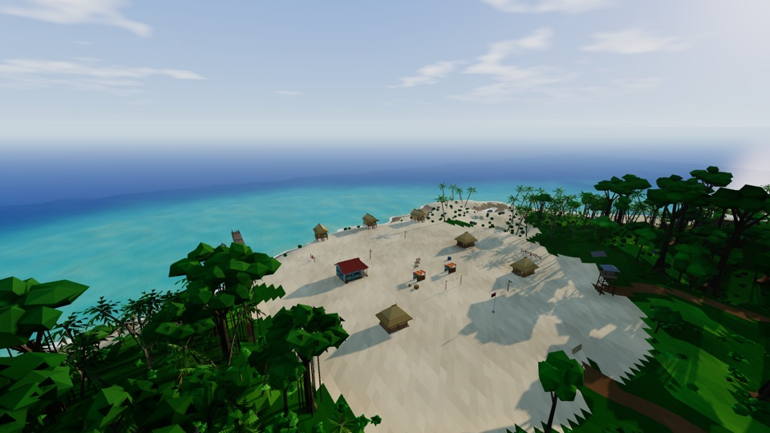

# Mini Cry — Isla Sombra

[](https://vvanghelue.github.io/mini-cry/)

A **low-poly** open-world FPS in the spirit of *Far Cry 1*: a 2 × 2 km tropical island (jungle,
lagoon, volcano, river, islets), mercenary outposts to liberate, a scripted story of 7 missions +
side missions — with its own **engine**, **editor** and **tools for AI agents**. Three.js + Vite,
with no binary art files apart from the rigged Quaternius characters: everything else (models,
sounds, terrain) is described in JSON and generated. The game and editor UI are in French.

**Demo**: https://vvanghelue.github.io/mini-cry/ (game) · https://vvanghelue.github.io/mini-cry/editor.html
(editor, read-only: saving needs the dev server).

```bash
npm install
npm run dev          # http://localhost:5190  (game)   ·   /editor.html  (editor)
```

## The game

- **Island**: procedural terrain (1025² heightmap, chunked LOD), ocean and rivers in shaders,
  ~145,000 instanced plants (palms, jungle giants, bamboo, ferns…), grass around the player,
  day/night cycle with cascaded shadows, baked probe GI with auto exposure, ambient occlusion
  (SSAO), cloudy sky, fog, lens flare, light halos.
- **FPS combat**: machete (stealth takedowns), pistol, SMG, AK, M4, shotgun, scoped sniper rifle,
  rocket launcher, grenades. Spread, recoil, aiming, reloading, location-based damage
  (head / body / limbs).
- **AI**: detection meter (distance, central / peripheral vision, visible part of the body,
  stance, movement, bushes in the line of sight, night, alertness), hearing (gunfire, explosions,
  running), patrols, investigation, cover combat, bursts, grenades, squad alerts (a lookout shot
  before they can shout warns no one), runner to the alarm → reinforcements. Fleeing civilians.
- **Open world**: 10 outposts to liberate (fast travel), binoculars to tag enemies, drivable jeep
  and boat, explosive barrels, pickups, 8 relics and 6 intel files.
- **Story**: *Échoué → Puerto Viejo → Ondes courtes → Le fleuve → Le laboratoire → Ailes coupées →
  La Fortaleza*, + 3 side missions. Subtitled radio dialogue (recorded French voices, optional),
  cutscenes, checkpoints.
- **100 % procedural audio**: 74 synthesized sounds (weapons, impacts, footsteps, UI, day / night /
  underwater ambiences, music that builds up with combat).

**Controls**: WASD/ZQSD · mouse · click fire · right click aim · R reload · E use / drive ·
G grenade · V machete · Shift sprint · Ctrl crouch · Space jump / swim · B binoculars · M map ·
1–5 weapons · Esc pause · F3 stats (FPS / CPU / GPU / draw calls / memory) · F2 debug panel
(cheats, missions, time of day, graphics). Both are shown by default (`?stats=0` / `?debug=0`
hide them).

## The editor (`/editor.html`)

| Tab | Purpose |
|---|---|
| 🗺 Monde | 3D level: selection, gizmo (W/E/R), placement from the content browser (buildings, props, vegetation, vehicles, weapons, characters, logic), outliner, inspector generated from the schemas, terrain sculpting / painting, vegetation brush, path editing, undo/redo, ▶ play from the camera |
| ⛰ Île | Island layout (islands, mountains, plateaus, lagoons, rivers, roads, sites) and terrain + vegetation regeneration |
| ☀ Ambiance | Time of day, sun, moon, sky, fog, clouds, wind, ocean colours — live |
| 🎯 Missions | Missions, objectives, triggers, conditions, actions, reference validation, direct testing |
| 💬 Dialogues | Radio characters, lines, voice generation and playback |
| 📊 Gameplay | Weapons, ammo, enemies (archetypes & palettes), player, items, plant species |
| 🧱 Assets | Low-poly model editor (parts, generators, colliders, LOD) with 3D preview |
| 🔊 Audio | Procedural sound designer (layers, envelopes, filters) with waveform and playback |

Ctrl+S saves (files go to `public/data/`, a backup copy is kept in `.mc-backup/`).

## Tools for AI agents

All content is readable JSON that can be edited without a browser, and an agent can **see** and
**play** the game headless on the real GPU:

```bash
npm run mc -- help                       # the CLI (terrain, vegetation, assets, entities, missions, sounds, GI, voices, validation, live)
npm run mc -- validate                   # checks assets, schemas, mission references…
npm test                                 # headless regression scenarios (tests/*.play)
npm run mc -- terrain preview            # top-down map -> shots/map.png
npm run mc -- asset shot hut_stilt --colliders   # render an asset -> PNG
npm run shot -- --at outpost_river --tod 17      # capture a viewpoint of the world
npm run play -- --spawn x,y,z,yaw --steps "wait 2; key KeyW 1; click 0.5; shot test; state"
npm run bench -- --mode play [--prod]    # performance per viewpoint (fps, CPU/GPU ms, draw calls)
npm run profile -- --spawn x,y,z         # CPU profile aggregated per function
node tools/trace-flight.mjs --prod       # Chrome trace of a fast flyover: long frames and their cause
npm run mc -- live state                 # drive a game / editor open in a browser
```

See `CLAUDE.md` (agent guide), `docs/ASSETS.md`, `docs/MISSIONS.md`, `docs/AUDIO.md`, `docs/GI.md`.

## Architecture

```
src/engine/   generic engine
  core/       Engine (loop, systems, dynamic resolution, CPU/GPU perf), Input, Data, Live, FlyCamera
  render/     Lighting (day/night, sky, low-poly materials, wind), SunShadows (cascades), SSAO, GI, LensFlare, Glows, InstancedField, StaticBatch
  world/      TerrainData / TerrainGen / TerrainRenderer, Water, Vegetation (+ scatter), Grass, Entities, World
  physics/    Physics (spatial grid, boxes/cylinders/spheres, character, raycasts)
  assets/     ModelBuilder (JSON -> geometry), generators (palm, tree…), AssetLibrary
  anim/       Characters (merged Quaternius characters, UAL animation retargeting, hitboxes)
  audio/      synth (recipe rendering, worker) + AudioSystem (3D, ambiences, music)
src/game/     the game: Game, player/ (controller, weapons), actors/ (actors, AI, navigation), missions/,
              entities/ (game entity types), vehicles/, fx/, ui/ (HUD, menus, map)
src/editor/   the editor (Preact): core.js + ui/ + panels/
public/data/  all the data: terrain/, assets/, world.json, vegetation.*, environment.json, gi/,
              sounds.json, voice/, game/ (player, weapons, archetypes, items, missions, dialogue)
tools/        mc CLI + headless tools (shot, play, bench, profile) + content/seed-world.mjs
```

**Performance** (target: 120 fps+ on a MacBook Air M1): flat-shaded Lambert materials without
textures, chunked LOD terrain, vegetation instanced per sector with LOD (far LODs of small plants
share a geometry), props merged per sector (static batching), shadows in 2–3 cascades with
decreasing refresh rate, half-resolution SSAO (depth pre-pass limited to the 80 m where it is
visible, 4x4 blur, applied to the ambient light in the materials), characters merged into a
single skinned mesh and removed from the scene graph when far away, animation rate reduced with
distance, pooled instanced effects, dynamic resolution.

Hitch-free streaming: instances (vegetation, grass) are uploaded to the GPU **in sector / tile
blocks** (`render/InstanceBlocks.js`): only the blocks that come in or go out are transferred (a
few KB per frame instead of ~76 MB/s in a fast flyover), and a sector is only reprocessed when it
crosses a LOD distance. Every shader (main pass + shadow pass, characters, first-person weapons,
material variants not used yet) is compiled during the loading screen (`World.warmUp`,
~0.1–0.2 s): no compilation during gameplay (`npm test` reports late compilations, if any).

Measurement (`npm run bench -- --mode play --prod --m1 --repeat 3 --fresh`): 9 viewpoints in the
real game (enemies, AI, HUD), 1440×900, a fresh page per measurement. The `--m1` mode is a
**pessimistic** estimate of a 7-core-GPU MacBook Air M1 made on a faster machine: page CPU
throttled ×2 (the M1 is ~1.6× slower single-core) and measured GPU time ×1.9; estimated fps =
min(fps with throttled CPU, 1000 / (GPU ms × 1.9)). Latest result (median of 3): **every view
≥ 164 estimated fps on M1** (worst: the coast at sunset, 164; best: the fortress, 201); with the
CPU throttled ×2 the game runs at 233–318 fps, 163–240 draw calls per frame.

Smoothness (no throttling): straight flyover at 108 km/h for 8 s (`tests/stream_smooth.play`):
p50 3.7 ms, p99 6–6.6 ms, worst frame 7.9–9.4 ms, 0 to 2 frames > 8.3 ms out of ~2,100; in the jeep
(`tests/drive_smooth.play`): p99 5.6 ms, worst 7.3 ms. GPU measurements vary when other
applications use the GPU: always use `--repeat`. The "low" preset and dynamic resolution keep
headroom on weaker machines.

**Global illumination**: irradiance probes baked offline (`npm run mc -- gi bake`) and relit at
runtime for the time of day; they replace the hemisphere ambient, and auto exposure meters the
same probes at the camera. See `docs/GI.md`.

Credits: characters and animations — Quaternius (CC0, *Universal Animation Library*).
