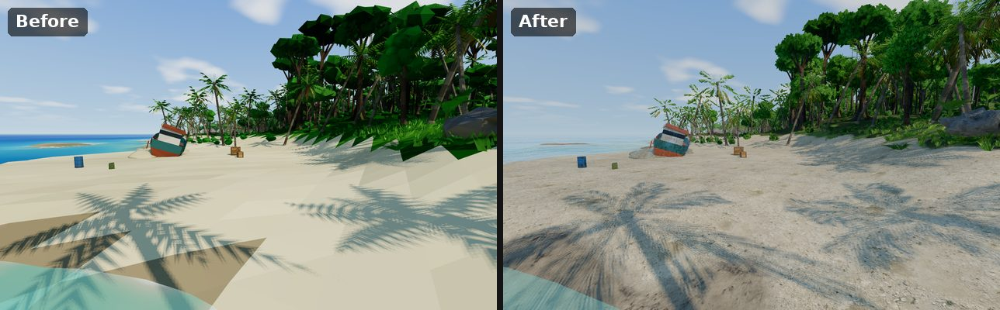
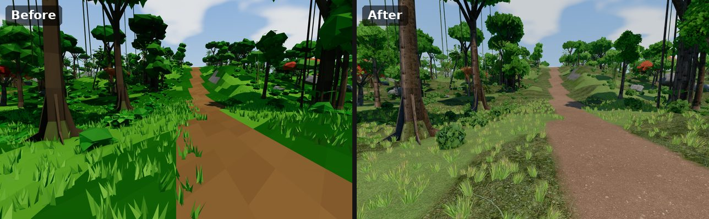
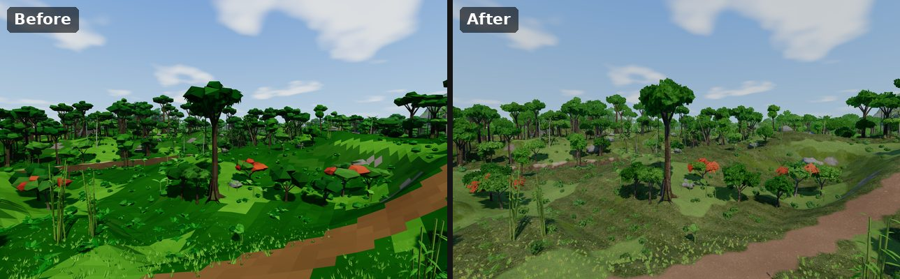
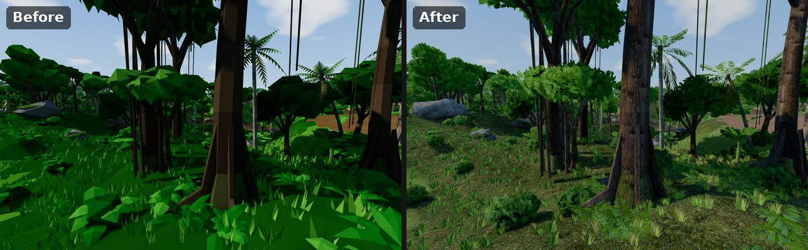
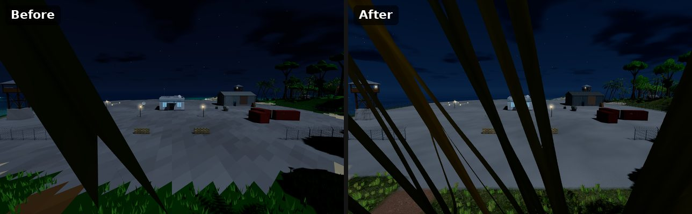
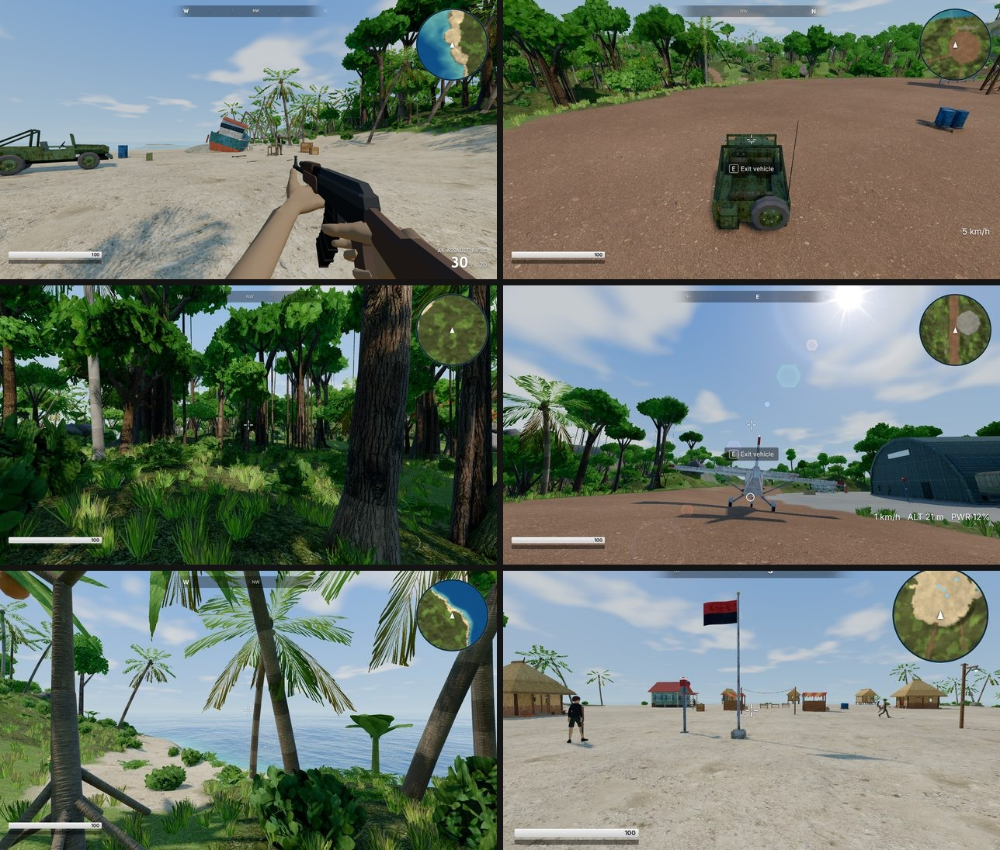

# Mini Cry — textures and materials

The island is drawn with photo-based CC0 textures and PBR materials (MeshStandardMaterial with
the engine's own sun, shadows, SSAO and probe GI injected). Everything still comes from data:
`public/data/textures.json` lists the texture layers and where they come from, `mc textures`
downloads and packs them, and the asset / terrain colours keep driving the look — the textures
add the detail.

## Sources

| group | what | from |
|---|---|---|
| `terrain` | 12 ground layers (sand, grass, leaf litter, red laterite, cliff rock, volcanic rock, mud, moss, ash, field, concrete) | [Poly Haven](https://polyhaven.com) (CC0) |
| `surfaces` | 16 opaque layers for props, buildings, bark, rocks (planks, worn wood, painted / rusty metal, corrugated iron, concrete, plaster, fort stone, rubble, thatch, linen, burlap, bark, palm bark, rock) | Poly Haven (CC0) |
| `foliage` | 10 alpha-cut atlases (leaf clusters, leaf mass, palm frond, fern, grass tuft, banana leaf, strap leaf, flowers) **composed** by `mc textures build` from leaf / grass scans | [ambientCG](https://ambientcg.com) (CC0) |
| `water` | ripple normal map | three.js examples (MIT) |

```bash
npm run mc -- textures fetch     # download the sources into .tex-cache/ (gitignored, kept between runs)
npm run mc -- textures build     # pack public/textures/*.webp|jpg, write layer means into textures.json
npm run mc -- textures build --only foliage   # one group
npm run mc -- textures info      # layers, sizes, file sizes
```

`textures fetch` needs network access (Poly Haven API + CDN, ambientCG, GitHub raw). On a proxied
machine run it with `NODE_USE_ENV_PROXY=1`. The packed files in `public/textures/` are committed,
so the game itself never downloads anything.

## Before / after

The same views with the former flat-shaded low-poly look and with the textured renderer
(`docs/realistic/`):













## Packing

Each group is **one tall strip image** (layers stacked vertically) uploaded straight into a WebGL2
texture array — `texImage3D` slices an image source by layer height — so a group is one fetch and
one decode, with no per-layer canvas work (`src/engine/render/Surfaces.js`). Mipmaps are generated
on the GPU, sampling is trilinear + 8x anisotropic.

| file | content |
|---|---|
| `terrain_albedo.webp` | 1024² layers: albedo (cavity AO baked in) + **A = height** (≥ 40/255) for height-blended splatting |
| `terrain_normal.jpg` | 512² layers: RG = normal xy (OpenGL), B = roughness |
| `surfaces_albedo.webp` / `surfaces_normal.jpg` | 512² layers, same packing (A unused) |
| `foliage_albedo.webp` | 1024² layers: RGBA, A = opacity; transparent texels filled with nearby leaf colour (no dark fringes in the mips) |
| `water_normal.jpg` | 512² tiling ripple normal map |

Layer options in `textures.json`: `scale` (metres per repeat), `metal` (metalness 0.65),
`chroma` (share of the texture's own hue variation kept: rust and stains stay subtle on a
coloured part), `amount` (detail strength), `roughnessScale`. `mean` / `roughness` are written
by the build. Images are authored **tip-up**: a leaf's stem / a frond's base is at the bottom.

## How a colour becomes a textured surface

The shaders divide each texel by its layer's **mean colour** (`surfRel`: luminance ratio x a
`chroma` share of the hue ratio), then multiply by the part / vertex colour. A red barrel stays red
with metal wear, a wooden plank keeps its palette brown with real grain, and the GI bake (which
only knows vertex colours) stays consistent with what is drawn.

- **Assets** (`src/engine/assets/ModelBuilder.js`): every vertex carries `uv` (metric: box mapping
  for boxes / prisms / raw triangles / rocks, cylindrical for cylinders and tubes, along-the-strip
  for fronds) and a `surface` id. A part's surface is `part.surface`, else the asset's `surface`,
  else from its `material` (`wood` → wood, `metal` → painted metal, `stone` → fort stone,
  `concrete`, `sand` → burlap, `cloth` → linen). Ids 0–63 are opaque `surfaces` layers, 64+ are
  `foliage` layers: alpha-cut, double-sided, alpha to coverage on the MSAA buffer, cast and occlude
  through their cut-out (the shadow / SSAO depth passes test the alpha). All props of a sector
  still merge into one mesh, all instances of a plant still share one mesh: the layer is picked
  per vertex in the shader. Normal maps use a cotangent frame from screen derivatives (no tangent
  attribute).
- **Terrain** (`src/engine/render/TerrainMaterial.js`): the resolved material id of every
  heightfield vertex is an R8 texture; each pixel blends the layers of its 4 surrounding vertices,
  sharpened by their height maps; top projection on gentle ground, triplanar on slopes; a second,
  much larger scale of each layer breaks the tiling with distance. `TERRAIN_MATERIALS`
  (`src/engine/world/TerrainData.js`) maps each terrain material to its colour and to a layer
  (`textures.json` `terrain.materials`), with optional `roughness` / `normal` / `chroma` scales.
- **Characters**: clothes get the fabric layer (uvs boxed from the bind pose), skin and hair stay
  plain, metal bits use smooth metal.
- **Water** (`src/engine/world/Water.js`): smooth swell + scrolling ripple normals, Fresnel between
  the absorbed body colour and the reflected sky and clouds, sun glint, light through the crests.

Lighting: MeshStandardMaterial (GGX sun specular with the cascaded shadows, probe GI or hemisphere
ambient), sky reflections for the indirect specular scaled by the probe sky visibility (no glowing
undersides), leaves with low specular and normals bent upward (thin, translucent). The colour
grade is AgX tone mapping with a mild contrast / saturation curve (`src/engine/render/Grade.js`).
`environment.json` `surface: { skySpecular, normalScale, detail }` tunes it live (`detail: 0` =
plain vertex colours, for A/B).

## Adding a texture

1. Add a layer to the right group of `textures.json` (`{ "id": "tiles", "polyhaven": "roof_tiles", "scale": 2 }`;
   foliage: a composer — `cluster`, `mass`, `frond`, `fern`, `grass`, `leaf`, `flowers` — with an
   ambientCG atlas id in `from`).
2. `npm run mc -- textures fetch && npm run mc -- textures build`.
3. Use it: `"surface": "tiles"` on asset parts (or on a whole asset), or map a terrain material to
   it in `terrain.materials`. Ids follow the manifest order: append rather than insert to keep
   saved assets stable (they store names, not ids, so reordering is safe too — only the packed
   files must be rebuilt).
4. Look at it: `npm run mc -- asset shot <name>`.
